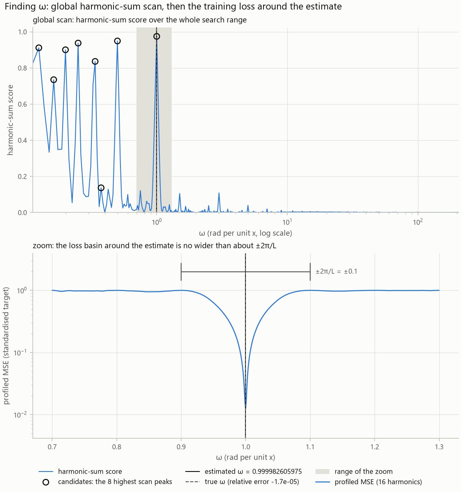
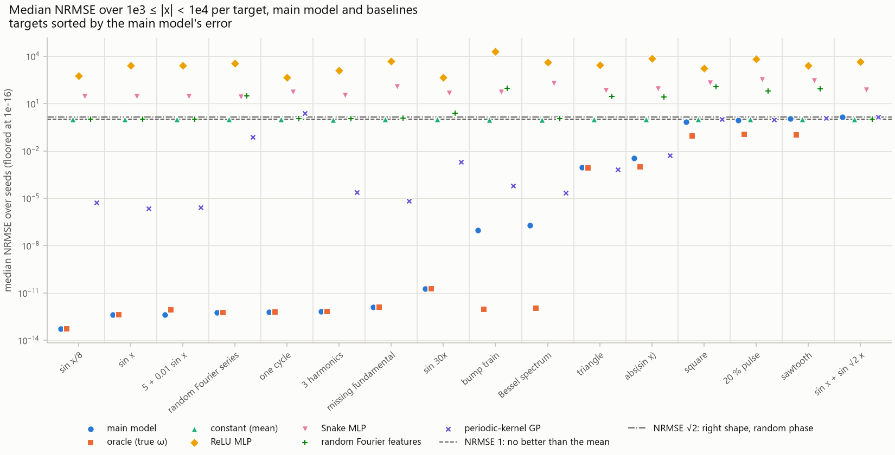
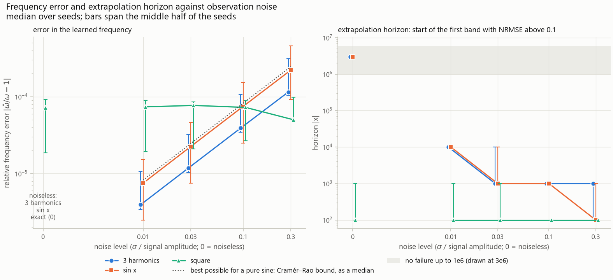
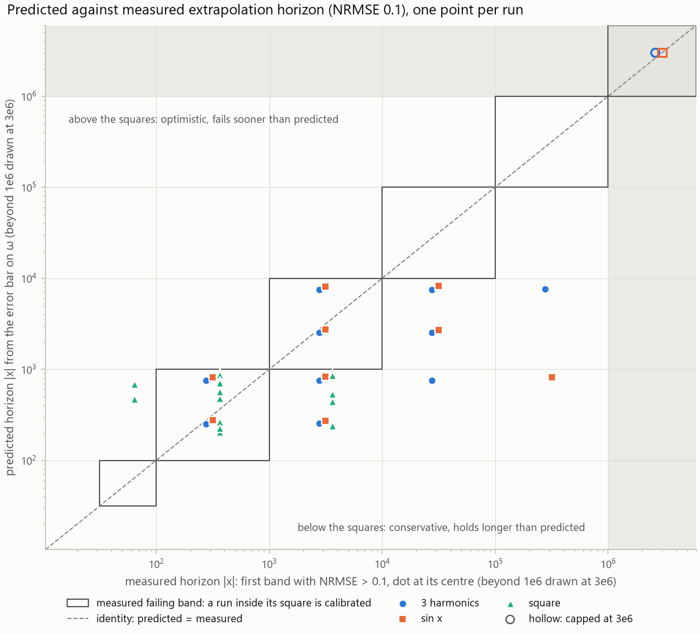
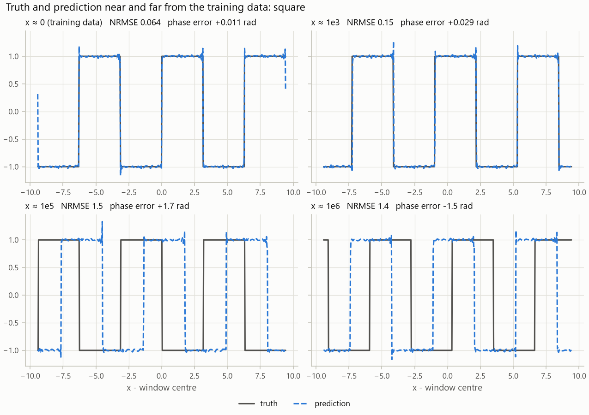

# periodic-extrapolation

Learn a bounded periodic function from samples on `[-10π, 10π]` and predict it anywhere, as far out as `|x| = 10⁶`.

The model is periodic by construction. It learns one fundamental frequency ω and the shape of a single cycle, and it sees each input only through its phase, its position within a cycle. The prediction therefore repeats forever, and how well it extrapolates comes down to how precisely ω is known: a frequency error δ shifts the phase by δ·|x|, which keeps growing with distance. Most of the engineering is about finding ω and about reporting how far the estimate can be trusted.

## Approach

**Model.** `ŷ(x) = m + s · h(θ)`, where `θ = ω (x − x_c) mod 2π` is the phase, `x_c` is the centre of the training window, and m and s undo the standardisation of the labels. The head h draws one cycle and comes in two kinds: a Fourier series (sines and cosines at the multiples kω of the fundamental, called harmonics) over the harmonics that carry energy, solved in closed form; or a small MLP (two SiLU layers of width 64) on `[cos kθ, sin kθ]` for the first four harmonics. Because x reaches the head only through θ, the prediction repeats exactly whatever the weights. Everything runs in float64: near `|x| = 10⁶`, float32 can only represent x to the nearest 0.06, which is already a 0.06 rad phase error.

**Finding ω.** As a function of ω, the training loss has a narrow well around the true value, reaching only about `2π/L` to either side (L is the window width, 20π), surrounded by a near-flat plateau full of shallow local minima. Gradient descent from a random start almost never lands in the well, so ω is found by a global search instead:

1. **Scan.** Compute a Lomb-Scargle periodogram (a power spectrum for unevenly spaced samples) on a grid from `2π/L` to the Nyquist frequency, and score each trial ω by the harmonic sum `Σ_k P(kω)`, the power at ω and its multiples. This way a fundamental with little or no power of its own (a missing fundamental, or peaks merged together) still ranks near the top. Fractions of the true frequency, ω/2, ω/3 and so on, score as high or higher, since their multiples include every true harmonic; step 3 sorts this out. The eight highest peaks become candidates.
2. **Refine.** For any trial ω the best Fourier coefficients have a closed-form least-squares solution, so the loss becomes a function of ω alone (variable projection). A bounded Brent search, then Newton iterations with the analytic gradient, refine each candidate to float64 precision in about twelve evaluations.
3. **Break ties.** Among candidates that fit equally well, within what the noise allows, keep the largest ω. A function that repeats every T also repeats every 2T, 3T and so on, so the fractions ω/k fit the data as well as ω does and can only be ruled out this way. Then, if only every m-th harmonic of the chosen ω carries energy, the true frequency is m·ω, and ω is raised to it. Together these settle which period is the real one without hardcoding anything.
4. **Estimate the error.** A standard error on ω from the Fisher information gives a predicted horizon: the distance at which a one-standard-error mistake in ω would make the prediction visibly wrong (NRMSE 0.1, defined under Results). It is reported with every run and checked against the measured horizon.

The figure shows both stages on the square wave. Top: the scan, with the eight candidates circled. Here the true ω = 1 scores highest, but its fractions ω/2 to ω/8 come close; on other targets one of them scores higher, which is why step 3 is needed. Bottom: the training loss near the estimate, a single well about ±2π/L wide.



**Training the head.** Both heads are fitted on the middle 80 % of the window and scored on the outer 10 % at each end: predicting an edge block from the middle is a short extrapolation, while a held-out block in the middle would only test interpolation. The better head is refitted on the whole window with ω frozen. The Fourier head is solved in closed form; the MLP uses full-batch Adam followed by L-BFGS. Fine-tuning ω jointly with the head was tried and dropped: it lowered the in-window loss but moved ω by 3e-7, enough to turn an error of 7.5e-11 at `10⁶` into 0.30.

**Data.** The window is cut into 4,096 equal cells and one input is drawn uniformly in each (stratified jitter). This leaves no large gaps and avoids the aliasing of a regular grid, where a fast oscillation can fit the samples exactly as well as a slow one. Label noise, when enabled, is Gaussian, with its standard deviation set relative to the signal amplitude.

**Loss.** Mean squared error on standardised labels throughout. Variable projection minimises this same loss, so the frequency search is part of training rather than a preprocessing step.

## Assumptions

- At least one full cycle fits inside the training window, so the period is at most `20π`; a longer period cannot be identified from data on the window. With fewer than two cycles the repetition is never fully observed and the estimate rests on the simplest fit; such runs are flagged `low_confidence`.
- The frequency lies below the Nyquist limit of the average sample spacing: about 205 rad per unit x at 4,096 samples, a period of about 0.03. Shorter periods need more samples.
- The black-box function is cheap to query, so the sample count is a free choice: 4,096 by default, with 64 to 16,384 tested.

## Results

Sixteen target functions cover short Fourier series (sin x, 3 harmonics, a 20-term random Fourier series), smooth shapes with long tails of small harmonics (a Bessel spectrum, a bump train), kinks (abs(sin x), triangle) and jumps (square, 20 % pulse, sawtooth). Edge cases add a missing fundamental (sin 2x + sin 3x, period 2π with no energy at ω = 1), a period equal to the window (one cycle: sin x + sin 1.1x), very fast and very slow sines (sin 30x, sin x/8), a large offset (5 + 0.01 sin x) and one function that is not periodic (sin x + sin √2 x).

Each target runs with five seeds, 4,096 samples and no noise. Error is reported as NRMSE, the RMSE divided by the target's standard deviation over one period: 0 is perfect, 1 is no better than predicting the mean, and √2 is the right shape at a random phase. Test distances are grouped into bands (31 to 100, 100 to 1,000, and so on up to 10⁶), and the extrapolation horizon is the start of the first band where NRMSE exceeds 0.1.

| Targets | ω relative error (median) | NRMSE at 1e3 to 1e4 | Horizon |
| --- | --- | --- | --- |
| sin x, 3 harmonics, missing fundamental, one cycle, sin 30x, sin x/8, random Fourier series, 5 + 0.01 sin x, and 10 held-out random series | 0 (exact in float64) | 5e-14 to 2e-11 | beyond 1e6 |
| Bessel spectrum, bump train | 1e-11 | 1e-7 | beyond 1e6 |
| Kinks: abs(sin x), triangle | 2e-7, 6e-8 | 3e-3, 9e-4 | 1e5, beyond 1e6 |
| Jumps: square, 20 % pulse, sawtooth | 7e-5, 7e-5, 1.4e-4 | 0.7 to 1.1 | 100, 100, 31 |
| sin x + sin √2 x (not periodic) | n/a | 1.4 | 31 |

On the eight targets that are finite Fourier series, and on all ten held-out series, the model is as accurate as an oracle, a Fourier fit given the true period: both reach 5e-14 to 2e-11. The held-out series have a random fundamental and random harmonics, drawn from a seed fixed after development. On the Bessel spectrum and the bump train the model trails the oracle, 1e-7 against 1e-12: their long tails of tiny harmonics are partly dropped, and ω shifts slightly to absorb the misfit (see "Keep every harmonic that carries energy" below).

The figure compares the model with the oracle and five baselines on every target, at distances of 1,000 to 10,000.



The strongest baseline is a Gaussian process with a periodic kernel, started from our own ω estimate. It reaches 2e-6 to 2e-3 on most smooth targets and edges out our model on the triangle wave (6.6e-4 against 9.4e-4), but it only gets to 0.08 on the random Fourier series and fails on the one-cycle target and on jumps. A ReLU MLP extrapolates linearly, so its error grows with distance; here it reaches 400 to 20,000. An MLP with Snake activations, which were proposed for learning periodic functions, reaches 30 to 300. Random Fourier features do no better than the mean (about 1) on simple targets, and reach 26 to 120 on targets with kinks, jumps or many harmonics. The constant predictor sits at 1 by construction.

Two ablations show why the global search matters. Starting from a random ω and training with Adam fails in 12 of 12 runs and never even fits the training window. Starting a few wells away from the true ω (the periodogram peak shifted by one to five times `2π/L`) fails in 10 of 12; the two successes converged to ω/2, which still extrapolates correctly.

With noise added, the error in ω follows the Cramér-Rao bound, the best accuracy an unbiased estimator can reach. On `sin x` the median error is 7.5e-6, 2.3e-5, 7.5e-5 and 2.2e-4 at 1, 3, 10 and 30 % noise, right at the bound, and the horizon falls from 1e4 to 1e2. The square wave stays near 7e-5 at every noise level, because its error comes from locating the jumps, not from noise (see Limitations).



Each run also predicts its own horizon from the error bar on ω, and that prediction errs on the safe side. Over the 40 noisy runs on `sin x` and the three-harmonic target, it lands inside the measured failing band 15 times and is too cautious the other 25, 22 of those by less than a factor of four; it never promises more than the model delivers. On the square wave 3 of 20 noisy runs overshoot, because the error bar misses the bias from locating the jumps. In the figure each dot is one run, placed at its measured failing band; a dot inside its band's square means the prediction was right.



## Limitations and failure cases

- **Jumps are information-limited.** Each jump can only be located to within one sample gap, so the ω error stops improving near 7e-5, and more samples barely help (5e-5 at 16,384). The reported error bar only accounts for noise and misses this bias, so it is too optimistic: on noiseless jump targets the predicted horizon is a median 9 times the measured one (0.5 to 37 times) and lands beyond the failing band in 7 of 15 runs. The square wave below shows the resulting drift. At x ≈ 1,000 the curves look identical, yet NRMSE is already 0.15: each jump is a few thousandths of a period out of place, and on a square wave all of the error sits in those slivers. By 10⁵ the prediction is about a quarter cycle out of phase (1.7 rad).

  

- **Fewer than two cycles.** Exact without noise, but with noise the error bar on ω grows to the percent level.
- **Frequency ceiling.** The scan stops at the Nyquist limit of the average sample spacing, even though jittered sampling has no hard limit, so `sin 30x` needs roughly 600 samples or more.
- **Quasi-periodic input** (sin x + sin √2 x, which never exactly repeats) fails by design and says so: NRMSE 0.37 even inside the window, horizon 31.
- **Cost.** A run with both heads takes about 30 s; the full suite with six baselines takes about 90 minutes on 8 cores.

## What I would do with more time

- **Keep every harmonic that carries energy.** Some smooth shapes have many tiny high harmonics. Dropping them leaves a small systematic misfit inside the window; the frequency fit absorbs it by nudging ω, and any error in ω grows with distance. A lower threshold for keeping a harmonic, re-applied after ω is refined (which harmonics count depends on ω), would leave nothing for ω to compensate for.
- **Honest error bars.** The error bar on ω assumes the residual is white noise. On jumps and kinks the residual is structured ringing (the Gibbs oscillation a Fourier series makes near a sharp feature) that repeats every period, so it carries less independent information than the sample count suggests, and the error bar comes out too small. A sandwich estimator would measure the residual's actual structure instead of assuming it. The predicted horizon should also start from the error already present inside the window rather than assume the fit there is perfect.
- **Model jumps directly.** For a target with jumps, nearly all the information about ω is in where the jumps fall. A Fourier series can only smear a jump into ringing, and the ringing biases ω. Detected jumps give a sharper constraint: every jump must land between the two samples that straddle it, in every cycle, and that alone bounds ω. One sawtooth feature per jump would remove the ringing while keeping the model exactly periodic. Past that, the limit is the sample gap itself, which active sampling can shrink by querying extra points around each detected jump.
- **Kink features.** The same idea one derivative up: a kink is a jump in slope, so dedicated periodic kink features, placed jointly with ω, would replace the long tail of harmonics a Fourier series needs to draw a kink.
- **Stricter evaluation.** Distance bands finer than decades, so smaller improvements show. Test points dense enough to land in the narrow gaps around jumps, where the error concentrates. Jump targets whose jumps are away from x = 0, so no result depends on that coincidence. Held-out shapes with jumps, kinks and noise, since the current held-out series are smooth and the Fourier head solves them exactly.

## Reproduce

```bash
make setup                                   # locked environment (uv) + pre-commit hooks
make test                                    # test suite (132 tests)
make smoke                                   # tiny end-to-end run: train, evaluate, figures
make suite                                   # 16 targets x 5 seeds with baselines -> reports/suite
make sweeps                                  # noise, sample-count, held-out, ablation -> reports/
make examples                                # figures for six representative runs -> reports/examples
uv run periodic train --config configs/base.toml --set data.target=square
uv run periodic evaluate --run runs/<run-dir>
uv run periodic predict --run runs/<run-dir> --x 1000000 -31.4
```

Every run directory holds `config.json`, `env.json` (versions, git SHA), `omega.json` (candidates, standard error), `metrics.json`, `evaluation.json` and `figures/`. Sweeps write `results.csv`, `summary_by_target.csv` and figures under `reports/<name>/`; `reports/examples/` holds figure sets for six representative runs.

## Layout

```text
src/periodic/
  targets.py    black-box functions and their periods (evaluation side only)
  data.py       sampling, noise, caching, edge-block split
  spectral.py   frequency estimation: scan, variable projection, tie-break, error bar
  features.py   float64 phase and harmonic features
  models/       harmonic regressor (Fourier and MLP heads), baselines, ablations
  train.py      head selection and refit; inference.py loads and predicts
  metrics.py    bands, horizons, phase offset; evaluate.py, sweep.py, report.py, plots.py
configs/        base.toml, smoke.toml, sweeps/*.toml
tests/          unit, property (Hypothesis) and integration tests, incl. the leakage guard
```
